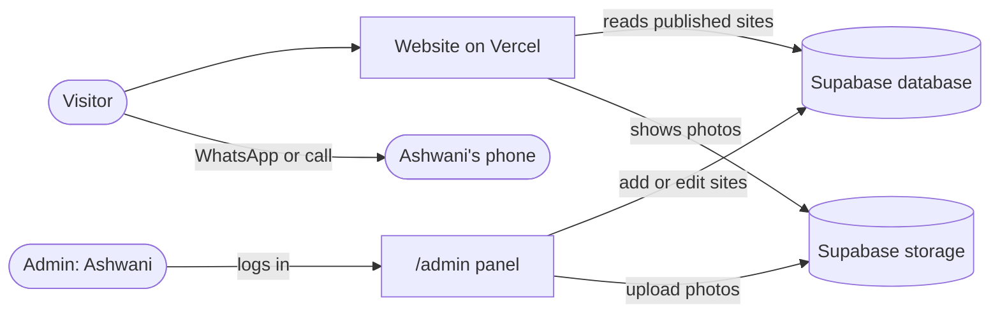
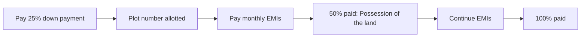

<div align="center">

# 🌿 Kshiraj Developers India Pvt. Ltd.
### *Your Land. Your Future.*

Verified residential plots in **Kanpur** and **Unnao**<br>
The personal website of **Ashwani Singh**, Sales Associate

[](https://ashwanisingh-kshiraj.vercel.app)
[](https://wa.me/917985055080)
[](https://ashwanisingh-kshiraj.vercel.app/admin)

<a href="https://wa.me/917985055080"></a><br>
<sub>Tap the icon to chat with Ashwani</sub>


</div>

---

## 🧭 Jump to

| I want to… | Go to |
|---|---|
| Understand what this website does | [What it does](#-what-it-does) |
| Add a site, change a rate, upload photos | [How-to guides](#-how-to-guides-click-to-open) |
| Understand the EMI table | [EMI plans explained](#-emi-plans-explained) |
| Set up Supabase for the first time | [Setup](#-first-time-setup-click-to-open) |
| Fix something that is not working | [Troubleshooting](#-troubleshooting-click-to-open) |
| Know where each file lives | [Project map](#-project-map) |

---

## ✨ What it does

- 🏠 **Home page:** hero with a live rate card, all sites, reasons to trust us, and an enquiry form.
- 📋 **Sites list (`/sites`):** filter by city (Kanpur, Unnao) and status (available, selling fast).
- 📍 **One page per site (`/sites/<site-name>`):** photo gallery with full-screen viewer, rate, plot sizes, facilities, documents, Google Maps link.
- 💰 **Down payment and EMI table** on every site page, with a plot-size calculator.
- 💬 **WhatsApp everywhere:** every button sends a ready message with the site name, rate and link.
- 🔐 **Admin panel (`/admin`):** add, edit, hide or delete sites and upload photos. No code needed.
- 📱 **Works on phones and desktops,** with a Call / WhatsApp bar fixed to the bottom on phones.

## 🔄 How it works



---

## 👥 Who are you? (click to open)

<details>
<summary><b>👤 I run the business (Ashwani)</b></summary>

<br>

You only need **two things**: the website address and your admin login.

1. Open `your-website/admin` and sign in.
2. Pick a site to edit, or press **+ Add new site**.
3. Change what you need, upload photos, and press **Save site**.
4. Open the website. The change is already there.

Jump straight to the [how-to guides](#-how-to-guides-click-to-open).

</details>

<details>
<summary><b>💻 I look after the code (developer)</b></summary>

<br>


```bash
npm install
npm run dev        # http://localhost:3000
npm run build      # check it compiles before pushing
```

Push to GitHub and Vercel redeploys automatically. Start with the [project map](#-project-map) and the [setup guide](#-first-time-setup-click-to-open).

</details>

---

## 🏘️ Starting sites

These 8 sites come from the rate-list poster. They are only the **starting data**. The live website reads from Supabase, so change real rates in `/admin`, not here. Rates are per sq yard.

| # | Site | City | Location | Rate (₹ / sq yd) |
|---|---|---|---|---|
| 1 | Kshiraj Ganga Pride | Kanpur | Ramnagar Sarsaul | 6,000 |
| 2 | Kshiraj Awas Yojana-2 | Unnao | Era Bhadiyar, Karimabad | 4,000 · 5,000 · 8,000 |
| 3 | Kshiraj Awas Yojana-3 | Unnao | Era Bhadiyar, Karimabad | 3,000 |
| 4 | Kshiraj Ganga City-2 | Unnao | Sikandarpur | 8,000 |
| 5 | Kshiraj Maharaj City-3 New | Kanpur | Maharajpur Rahnas | 7,000 |
| 6 | Kshiraj Chaubepur | Kanpur | Chaubepur Mariyani Shahpur Malha | 9,000 · 15,000 |
| 7 | Kshiraj Chaubepur-2 | Kanpur | Chaubepur Mariyani Shahpur Malha | 5,500 |
| 8 | Kshiraj Navsrijan Nawabganj | Unnao | Nawabganj Toll Plaza | 16,000 |

---

## 🛠️ How-to guides (click to open)

<details>
<summary><b>➕ Add a new site</b></summary>

<br>

1. `/admin` → **+ Add new site**.
2. Fill in the English name (required) and the Hindi name.
3. Choose the city and status, and type the location.
4. **Rate per sq yard:** numbers separated by commas, for example `4000, 5000, 8000`.
5. Add plot sizes, a description, facilities (one per line), documents (one per line) and a Google Maps link.
6. Upload photos, then press **Save site**.

The page address is made from the English name, for example `/sites/kshiraj-ganga-pride`. You can edit it before saving.

</details>

<details>
<summary><b>🖼️ Upload or change photos</b></summary>

<br>

1. `/admin` → click the site → **Photos** → choose images (you can pick several).
2. They are shrunk automatically (up to 1280 px wide) so pages load fast.
3. The **first photo is the cover.** It shows on the site cards and in the WhatsApp link preview. Use **Make cover** to change it, and the arrows to reorder.
4. ⚠️ Press **Save site.** Photos are only saved after that.

</details>

<details>
<summary><b>💲 Change a rate or status</b></summary>

<br>

`/admin` → click the site → edit **Rate per sq yard** or **Status** (Available, Selling fast, Sold out) → **Save site**. The home page rate card, site cards and EMI table all follow the new rate.

</details>

<details>
<summary><b>🙈 Hide or delete a site</b></summary>

<br>

- **Hide for now:** untick **Show on website** and save. The site stays in admin.
- **Delete for good:** open the site and press **Delete site**. This cannot be undone.

</details>

<details>
<summary><b>📞 Change phone number, name or address</b></summary>

<br>

Edit `lib/config.js`:

| Field | What it controls |
|---|---|
| `person` | Name in the header logo, footer and share image |
| `phone` | The number shown and used for Call buttons |
| `whatsapp` | WhatsApp number with country code, for example `917985055080` |
| `address` | Office address in the footer and contact section |

Push to GitHub to publish. The share image updates on the next deploy.

</details>

<details>
<summary><b>📆 Change how many EMI years a site offers</b></summary>

<br>

Open `components/EmiPlan.jsx` and edit the list at the top:

```js
const MAX_YEARS = { "kshiraj-ganga-pride": 4 };
```

A site listed here offers EMI up to that many years. **Every other site offers 5 years.** Use the site's page address on the left.

</details>

<details>
<summary><b>🤖 Show or hide the "AI-generated image" note</b></summary>

<br>

The 8 site pictures are AI-generated, so the gallery shows a small tag and a note. Once a site has real photos, open `components/Gallery.jsx` and set:

```js
const SHOW_AI_NOTE = false;
```

This switches the note off for **all** sites at once.

</details>

<details>
<summary><b>🎨 Change colors, fonts or the hero photo</b></summary>

<br>

- **Colors:** `tailwind.config.js` (navy, leaf green, gold, paper).
- **Fonts:** `app/layout.jsx` (Fraunces, Figtree, Hind for Hindi text).
- **Hero background photo:** replace `public/hero.jpg`. Use a photo you have the licence to use.

</details>

---

## 💰 EMI plans explained

Every site page shows an **example** table. The visitor picks a rate and plot size (in steps of 50 sq yard), then taps a plan to ask about it on WhatsApp.



| Rule | Value |
|---|---|
| Down payment (example) | 25% of rate × plot size |
| Balance | 75%, split into equal monthly EMIs with **no interest** |
| Plans | 1 to 5 years (12 to 60 months). Kshiraj Ganga Pride: up to 4 years |
| Plot number | Allotted at 25% paid |
| Possession | At 50% paid, which is after one third of the EMIs |
| Plot size | Always rounds to the nearest 50 sq yard |

**Example:** Ganga Pride at ₹6,000 × 100 sq yd = ₹6,00,000 → down payment ₹1,50,000 → 3-year EMI ₹12,500 × 36 months → possession after EMI 12.

> ⚠️ **The table is only an example.** The actual down payment is lower than 25%. A highlighted note on every site page says so and asks visitors to call for exact details. If the real terms include interest, the maths in `components/EmiPlan.jsx` must change.

---

## 💬 WhatsApp messages and link previews


- On a site page every WhatsApp button (header, bottom bar, side card, EMI note, form) sends a message with the **site name, location, rate and link**.
- WhatsApp **cannot attach a picture through a link.** Instead it shows a preview card with the site's cover photo and name, built from the page's Open Graph tags.
- Sites without a photo (and the home page) use the branded share image at `app/opengraph-image.jsx`.
- Preview cache: WhatsApp and Facebook remember old previews. Share the link in a new chat to test, or use Facebook's Sharing Debugger and press **Scrape Again**.

---

## 🚀 First-time setup (click to open)

<details>
<summary><b>1️⃣ Create the Supabase project and tables</b></summary>

<br>

1. Sign up at [supabase.com](https://supabase.com) and press **New project**.
2. Open **SQL Editor** → **New query**.
3. Paste all of [`supabase/schema.sql`](supabase/schema.sql) and press **Run**.

This creates the sites table, the visitor rules and the photo storage.

</details>

<details>
<summary><b>2️⃣ Create the admin login and stop sign-ups</b></summary>

<br>

1. **Authentication → Users → Add user → Create new user.** Enter an email and a strong password, and tick **Auto Confirm User**.
2. **Authentication → Sign In / Providers:** turn **off** "Allow new users to sign up".

Any account can edit sites, so only your own user should exist.

</details>

<details>
<summary><b>3️⃣ Connect the website (Vercel)</b></summary>

<br>

1. In Supabase open **Project Settings → API** and copy the **Project URL** and the **anon / publishable key**.
2. In Vercel open **Settings → Environment Variables** and add them for **Production**:

| Name | Value |
|---|---|
| `NEXT_PUBLIC_SUPABASE_URL` | Your Project URL (`https://….supabase.co`) |
| `NEXT_PUBLIC_SUPABASE_ANON_KEY` | The anon / publishable key |
| `NEXT_PUBLIC_SITE_URL` | *Optional.* Your custom domain, if you add one |

3. If Vercel warns about the `NEXT_PUBLIC_` prefix, that is expected. Keep the prefix, and choose **Change to Config** or "Readable after saving".
4. **Redeploy**, then open `/admin`, sign in and press **Load the 8 starter sites**.

For local work, put the same two values in `.env.local`.

</details>

---

## 🗂️ Project map

```text
app/
├─ (public)/            Public pages (with header, footer, bottom bar)
│  ├─ page.jsx          Home
│  └─ sites/            Sites list and one page per site
├─ admin/               Login, site list and editor
├─ opengraph-image.jsx  Default share picture
└─ layout.jsx           Fonts and page title / share settings
components/             Hero, SiteCard, Gallery, EmiPlan, EnquiryForm, Whatsapp, SiteEditor …
lib/                    config.js (business details), sites.js (reads data), seed.js (starter sites)
assets/                 Font files used by the share image
public/hero.jpg         Hero background photo
docs/images/            README icons (WhatsApp and GitHub animations)
supabase/schema.sql     Database tables, rules and photo storage
tailwind.config.js      Colors and fonts
```

---

## 🔒 Security

- Visitors can only **read published** sites. Only the signed-in admin can add, change or delete.
- The Supabase URL and anon key are **meant to be public.** The database rules protect your data.
- 🚫 **Never** put the `service_role` / secret key in Vercel or in code.
- Keep **new sign-ups switched off** in Supabase.
- If two people edit the same site at once, the second save is refused with a warning instead of overwriting the first.

---

## 🩺 Troubleshooting (click to open)

<details>
<summary><b>"Admin needs Supabase" appears</b></summary>

<br>

The two Supabase variables are missing, are not ticked for **Production**, or you have not redeployed since adding them.

</details>

<details>
<summary><b>Sites added in admin do not show on the website</b></summary>

<br>

1. Check the site has **Show on website** ticked.
2. Open `/api/health` (if that test file is still in the project). It should report your site count.
3. Run this in the Supabase **SQL Editor** to make sure visitors can read sites:

```sql
drop policy if exists "public reads published" on public.sites;
create policy "public reads published" on public.sites
  for select to anon, authenticated using (published = true);
grant usage on schema public to anon, authenticated;
grant select on public.sites to anon;
grant select, insert, update, delete on public.sites to authenticated;
```

`lib/supabase.js` already asks for fresh data on every request, so an old cached copy should not be the cause.

</details>

<details>
<summary><b>Photo upload fails</b></summary>

<br>

Run `supabase/schema.sql` again (it creates the photo storage). Use JPG, PNG or WebP files under 25 MB. Type the English name first, because photos are filed under the site address.

</details>

<details>
<summary><b>The Vercel build fails on the share image</b></summary>

<br>

Check that the `assets/` folder contains all four font files: `Fraunces-800.woff`, `Fraunces-600-italic.woff`, `Figtree-700.woff` and `Figtree-400.woff`.

</details>

<details>
<summary><b>The WhatsApp preview shows no photo</b></summary>

<br>

The site needs a cover photo saved in admin. WhatsApp also keeps old previews for a while, so test the link in a new chat.

</details>

<details>
<summary><b>I cannot log in to admin</b></summary>

<br>

There is no default login. Use the email and password you created in Supabase under **Authentication → Users**. If it still fails, delete that user and create it again with **Auto Confirm User** ticked.

</details>

---

## 🗺️ Roadmap

- [x] Home page, sites list and one page per site
- [x] Admin panel with photo upload
- [x] EMI example table and WhatsApp messages
- [x] Share image for WhatsApp, Facebook, LinkedIn and X
- [ ] A separate offer line for each site (to replace the removed booking line)
- [ ] Real site photographs instead of AI-generated images
- [ ] Optional: per-site EMI years and AI-note switch inside admin
- [ ] Optional: a generated share card for each site

---

<div align="center">

<a href="https://github.com/Babamosie333"></a>

Built by **Vikram Singh** (Babamosie) for **Ashwani Singh · Kshiraj Developers India Pvt. Ltd.**<br>
📍 Shyam Nagar, UP · 📞 7985055080

</div>